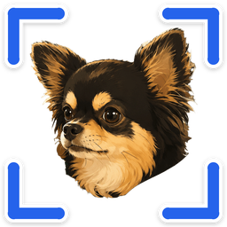

<h1 align="center">웅캡처 woong capture</h1>

광고 없는 무료 화면 캡처 프로그램 (Windows 10 · 11, 64비트) 
<b>Alt + 2</b> 를 누르고 끌기만 하면 캡처 → 바로 꾸미고 복사 · 저장

## ⬇️ 내려받기

### **[웅캡처 1.1.1 내려받기 (zip, 21MB)](https://github.com/joese0211/woong-capture/raw/main/download/woong-capture-windows.zip)**

SHA256: `991780EF6937E95C93A334B336B5ADAAB3D008ABBEE2DA4B65266BB6E4F9E3F0`

> **1.1.1 바뀐 점** — 내려받기 크기 35MB → 21MB, 설치 크기 91MB → 51MB 로 줄였어요. 쉬는 동안 메모리를 훨씬 적게 써요. 색 고르기 창도 한국어로 나와요.

## 설치하기

1. 받은 `woong-capture-windows.zip` 을 마우스 오른쪽 단추로 누르고 **[모두 압축 풀기]** 를 고릅니다.
2. 풀린 폴더 안의 **WoongCapture.exe** 를 두 번 누릅니다.
3. 파란 창 **"Windows의 PC 보호"** 가 뜨면 **[추가 정보]** → **[실행]** 을 누릅니다.
   (인증서를 사지 않은 작은 무료 프로그램이라 처음 한 번 보이는 안내예요.)
4. **"웅캡처 설치"** 창에서 **[설치하기]** 를 누르면 끝!
   화면 오른쪽 아래(시계 옆)에 강아지 아이콘이 생겨요. 안 보이면 작업 표시줄의 **[^]** 를 눌러 보세요.

설치는 내 계정에만 되고(`%LOCALAPPDATA%\Programs\WoongCapture`), 관리자 권한은 필요 없어요.
예전 이름 **hatelist01** 을 쓰고 있었다면 새로 설치할 때 자동으로 정리되고 설정은 그대로 옮겨져요.
설치가 끝나면 받은 압축 파일과 풀린 폴더는 지워도 돼요.

## 쓰는 법

| 하고 싶은 것 | 방법 |
|---|---|
| 캡처 시작 | **Alt + 2** |
| 원하는 부분만 | 끌어서 고르기 |
| 창 하나만 | 마우스를 창 위에 두고 한 번 누르기 |
| 화면 전체 | 위쪽 막대의 **[전체화면]** |
| 단축키 바꾸기 | 위쪽 막대의 **[설정]**, 또는 트레이 메뉴 **'단축키 설정…'** |
| 그만두기 | **Esc** |

- 캡처하면 **바로 복사**돼요. 카카오톡 · 메일 등에 **Ctrl + V** 로 붙여 넣으면 돼요.
- 편집기: 펜 · 형광펜 · 사각형 · 원 · 화살표 · 글자 · 모자이크
  — **Ctrl + C** 복사, **Ctrl + S** 저장, **Ctrl + Z** 되돌리기, **Esc** 닫기
- 강아지 아이콘을 오른쪽 단추로 누르면 창 캡처 · 전체화면 캡처 · 단축키 설정 · 저장 폴더 열기 · 자동 실행 · 프로그램 정보 메뉴가 나와요.

## 지우기

- Windows **[설정] → [앱] → [설치된 앱]** → 웅캡처 옆 **[⋯] → [제거]**
- 또는 강아지 아이콘 오른쪽 단추 → **[프로그램 정보…] → [프로그램 지우기…]**
- 저장해 둔 캡처 그림은 지워지지 않아요.

## 라이선스

웅캡처는 무료로 쓸 수 있어요. 함께 담긴 Qt 6 / PySide6 는 **LGPL-3.0** 으로, 고치지 않고 따로 떨어진 라이브러리 파일로 씁니다.
라이선스 원문(LGPL-3.0 · GPL-3.0 · Python PSF)과 소스 코드 받는 곳은 압축 안 `LICENSES` 폴더에 있어요.
